# Sports Venue Booking Platform

Microservices-based sports venue booking platform (Java/Spring Boot) with
event-driven Saga pattern, Docker, CI/CD, and an end-to-end API test suite.

**Status:** Core system complete (Aug 2026). End-to-end test suite added
(Nov 2026) - it found and drove fixes for five real bugs, documented below.
Optional enhancements listed below may be added as time allows.

## Architecture

6 independently deployable Spring Boot microservices, plus an API Gateway,
communicating via REST (synchronous) and RabbitMQ (asynchronous events for
the booking saga). Orchestrated locally with Docker Compose.

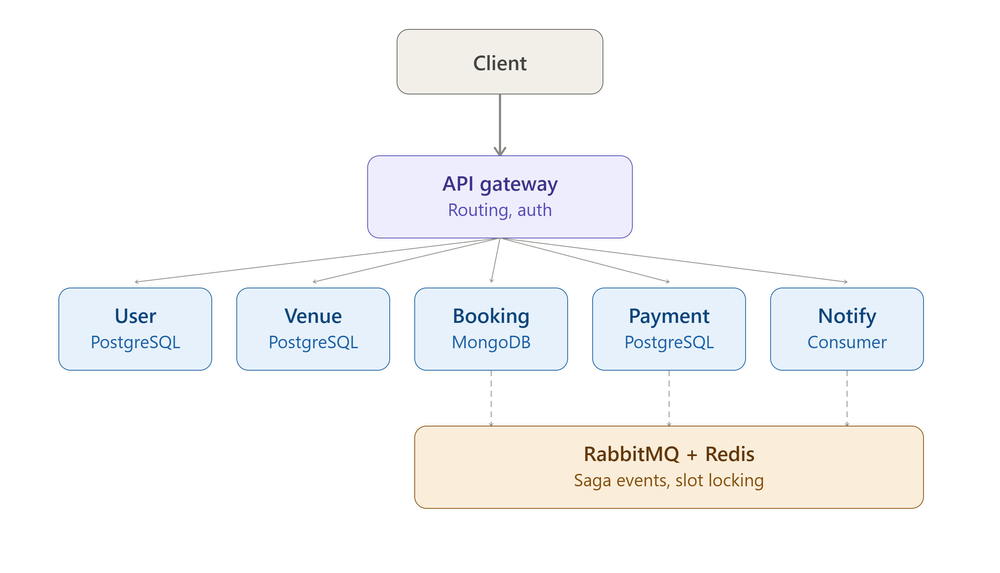

| Service              | Responsibility                                                                               | Database   | Status      |
| -------------------- | -------------------------------------------------------------------------------------------- | ---------- | ----------- |
| API Gateway          | Routing, JWT validation                                                                      | —          | ✅ Complete |
| User Service         | Auth (JWT), user profiles, RBAC                                                              | PostgreSQL | ✅ Complete |
| Venue Service        | Venue/court management, browse/search                                                        | PostgreSQL | ✅ Complete |
| Booking Service      | Booking lifecycle, Saga orchestration (confirm/cancel on payment result), Redis slot-locking | MongoDB    | ✅ Complete |
| Payment Service      | Payment processing (event-driven, simulated)                                                 | PostgreSQL | ✅ Complete |
| Notification Service | Email notifications (event consumer, delivery status + retry)                                | PostgreSQL | ✅ Complete |

## Tech Stack

- Java 25, Spring Boot 4.1.0, Maven
- PostgreSQL, MongoDB, Redis, RabbitMQ
- Spring Cloud Gateway (reactive/WebFlux)
- Docker, Docker Compose, GitHub Actions CI/CD
- Testcontainers, JUnit 5, Mockito, AssertJ
- Playwright (Python) + pytest - end-to-end API and UI test suite
- GitHub Container Registry (image publishing)
- Spring Mail + Mailpit (local email capture, default) / Mailtrap (optional sandbox)

## Getting Started

**Prerequisites:** Docker, Docker Compose

```bash
git clone https://github.com/ahmadisyraf39/sports-venue-booking.git
cd sports-venue-booking
docker compose up
```

No accounts or credentials needed: emails are captured locally by Mailpit.
This starts all 6 services plus PostgreSQL (×4), MongoDB, Redis, RabbitMQ,
Mailpit, and the observability stack. Once running:

- **Gateway (single entry point):** http://localhost:8080
- **Mailpit (emails sent by the saga):** http://localhost:8025
- **RabbitMQ management UI:** http://localhost:15672 (guest/guest)
- Individual services (except booking-service, which runs behind the
  gateway) are also reachable on their own ports (8081-8085) for debugging -
  see each service's own README.

**Sending real emails to Mailtrap instead (optional):** copy `.env.example`
to `.env`, add your Mailtrap sandbox credentials, and uncomment `MAIL_HOST`
and `MAIL_PORT`.

**Postman:** [`/postman/collection.json`](./postman) - every request goes
through the gateway. Run the collection top to bottom with the Collection
Runner: it registers a fresh user, stores the JWT, walks through the whole
booking saga, and checks the negative cases (401/400/403/404/409).

**End-to-end tests:** see [Testing](#testing) below or
[`e2e-tests/README.md`](./e2e-tests).

## The Booking Saga, end to end

```
Client -> Gateway (JWT validated) -> Booking Service
                                       |
                          checks Venue Service for court + real price
                                       |
                          acquires Redis lock (court + date), checks for overlapping bookings
                                       |
                          saves Booking (PENDING), publishes BookingCreated
                                       v
                                Payment Service
                          (consumes event, simulates payment,
                           publishes PaymentConfirmed / PaymentFailed)
                                       |
                 +---------------------+----------------------+
                 v                                            v
          Booking Service                           Notification Service
   (PaymentConfirmed -> CONFIRMED,          (saves a NotificationLog, sends the email,
    PaymentFailed -> CANCELLED:              records SENT / FAILED; failed emails are
    compensation frees the slot)             retried with backoff)
```

A single `POST /api/bookings` request through the Gateway triggers this
entire chain automatically. Booking Service and Notification Service each
have their **own** queue bound to the payment exchange, so both receive every
payment event (sharing one queue would make them competing consumers).

The whole chain is verified automatically by the e2e suite on every pull
request: booking becomes `CONFIRMED`, exactly one `CONFIRMED` payment exists,
the notification is `SENT`, and exactly one email about that booking reaches
the mail server.

## Key Design Decisions

- **Polyglot persistence**: PostgreSQL for relational, consistency-critical
  data (users, venues, payments, notifications); MongoDB for Booking
  Service's naturally nested, flexible document data.
- **JWT authentication**: issued by User Service, validated at the Gateway
  (a reactive `GlobalFilter`) - public paths (`/api/auth/**`) pass through
  unchecked, everything else requires a valid Bearer token.
- **Event-driven Saga**: Booking Service orchestrates booking -> payment ->
  notification via RabbitMQ, with each service only aware of the events it
  publishes/consumes, not of other services' internals. A failed payment
  triggers a compensating action: the booking is cancelled and its slot freed.
- **Redis-based slot locking**: an atomic `SETNX` lock per **court + date**
  (10s auto-expiring safety net) serialises the overlap check and save for
  that court's day, so concurrent requests can't double-book - including
  bookings with different start times but overlapping hours. Requests that
  find the lock taken wait and retry briefly (up to 2s) instead of failing,
  so non-overlapping bookings on the same court still both succeed.
- **Idempotency guards**: Payment, Booking and Notification services all
  tolerate RabbitMQ's at-least-once delivery - payments check for
  already-processed events, bookings only move out of `PENDING` once, and
  notifications only skip events that were actually `SENT` (a real duplicate
  was caught live during development, see `notification-service/README.md`).
- **Retry with backoff for notifications**: a failed email is recorded as
  `FAILED` and retried by the listener's retry policy (4 attempts, 2s -> 10s)
  instead of being silently lost or retried in a tight loop.

## Testing

| Layer          | What                                                                                                                       | Where                       | Runs in CI                                       |
| -------------- | -------------------------------------------------------------------------------------------------------------------------- | --------------------------- | ------------------------------------------------ |
| Unit           | Service logic with mocked dependencies (JUnit 5, Mockito, AssertJ)                                                         | `*/src/test`                | Per-service workflow, on changes to that service |
| Integration    | Repositories and controllers against real databases (Testcontainers)                                                       | `*/src/test`                | Per-service workflow                             |
| **End-to-end** | The whole system through the API Gateway, exactly like a client, plus browser tests of the demo page (Playwright + pytest) | [`e2e-tests/`](./e2e-tests) | `e2e-tests` workflow, on **every** pull request  |

### End-to-end suite

40 tests: 32 API tests that only talk to the gateway over HTTP - no knowledge
of the Java code - and 8 browser tests of the double-booking demo page. Each
run registers a fresh user and creates its own venues, courts and bookings,
so tests never depend on existing data.

| Area            | Covered                                                                                                                                                                                                                            |
| --------------- | ---------------------------------------------------------------------------------------------------------------------------------------------------------------------------------------------------------------------------------- |
| Smoke           | Gateway health; every service reachable through the gateway with a JWT                                                                                                                                                             |
| Auth            | Login returns a JWT; wrong password 401; duplicate email 409; short password 400; missing / invalid / wrong-scheme tokens 401                                                                                                      |
| Venues & courts | Create, get, partial case-insensitive search, courts listed under a venue, unknown venue 404, non-owner delete 403 (venue untouched), missing name 400                                                                             |
| Booking saga    | Booking starts `PENDING` with the correct price; payment `CONFIRMED`; booking becomes `CONFIRMED`; notification `SENT`; exactly one email for that booking in Mailpit; same slot twice 409; invalid duration / past date 400       |
| Concurrency     | 2 and 10 simultaneous requests for the same slot - exactly one wins, one booking saved; overlapping slots with different start times - only one wins; non-overlapping slots - both succeed                                         |
| Demo page (UI)  | Page loads with defaults; missing-token hint; single booking succeeds; "Fire Both" - exactly one panel wins, the other shows 409; invalid token shows 401; 409 / 500 / network errors (mocked with `page.route`) shown as failures |

The UI tests use the Page Object Model (`RaceDemoPage`, `BookingPanel`), so
tests read as steps, and mock error responses with `page.route` instead of
breaking the backend.

In CI the workflow builds and starts the full Docker Compose stack, waits
until every service answers through the gateway, installs Chromium, runs the
suite (no secrets needed), and on failure prints service logs and keeps
screenshots and Playwright traces of failed UI tests.

### Bugs found by the e2e suite

Each was handled the same way: a failing test committed first as proof, then
the fix, then the same test passing.

| Bug                            | Symptom the test saw                                                                    | Root cause                                                                                                                                                                | Fix                                                                                                                                                                         |
| ------------------------------ | --------------------------------------------------------------------------------------- | ------------------------------------------------------------------------------------------------------------------------------------------------------------------------- | --------------------------------------------------------------------------------------------------------------------------------------------------------------------------- |
| Validation errors returned 403 | Short password on register gave **403** instead of 400                                  | Spring Boot forwards unhandled exceptions to `/error`, which Spring Security didn't permit - so the error page itself was blocked                                         | Permit `/error`; handle `MethodArgumentNotValidException` in User Service and return 400 with the failing fields                                                            |
| Saga never completed           | Booking stayed `PENDING` forever, even after payment was `CONFIRMED`                    | Booking Service published `BookingCreated` but never consumed the payment result                                                                                          | Booking Service consumes `PaymentConfirmed` / `PaymentFailed` on its own queues, with idempotent `PENDING -> CONFIRMED / CANCELLED` transitions                             |
| Overlapping double bookings    | 10:00-12:00 and 11:00-12:00 sent simultaneously were **both** accepted                  | The Redis lock key included the start time, so overlapping bookings took different locks and ran the overlap check in parallel                                            | Lock per court + date with a short retry; a guard test keeps non-overlapping bookings succeeding in parallel                                                                |
| Failed emails silently lost    | Notifications missing under load; logs showed Mailtrap `550 Too many emails per second` | The log row was saved before sending, so RabbitMQ's redelivery hit the idempotency check and skipped the retry - the email was never sent, but recorded as if it had been | Send first, then record `SENT` / `FAILED`; only `SENT` is treated as a duplicate; retry with backoff. Mailpit made the default so tests don't depend on a third-party quota |
| Demo page crashed on 401       | An invalid token showed _"Unexpected end of JSON input"_ instead of the 401             | The gateway rejects bad tokens with an empty body, but the page always called `response.json()`                                                                           | Read the body as text and parse it only if it's JSON; show a clear "token missing, invalid or expired" hint for 401                                                         |

## Known Simplifications

- Recipient email addresses are derived from user ID as a placeholder
  (`user{id}@example.com`), since real emails aren't yet passed through the
  event chain from User Service.
- Payment processing is simulated and always succeeds - no real payment
  gateway integration (a deliberate scope decision; the focus is the
  event-driven architecture). The cancellation path is covered by unit tests.
- Service-to-service URLs are direct/hardcoded (via environment variables),
  not resolved through a service registry like Eureka.
- Notification emails are retried with backoff, but there is no dead-letter
  queue: after the final attempt the message is dropped and the notification
  stays `FAILED` in the database.
- Email delivery is at-least-once: if the service crashed after sending but
  before recording `SENT`, the retry would send a duplicate.
- Database schemas are managed by Hibernate `ddl-auto: update`, not a
  migration tool such as Flyway - schema changes may require resetting local
  volumes (`docker compose down -v`).
- Bookings have no cancel or delete endpoint yet.

## Screenshots

**Full stack running locally via Docker Compose** - all 6 services, 4
PostgreSQL instances, MongoDB, Redis, and RabbitMQ:

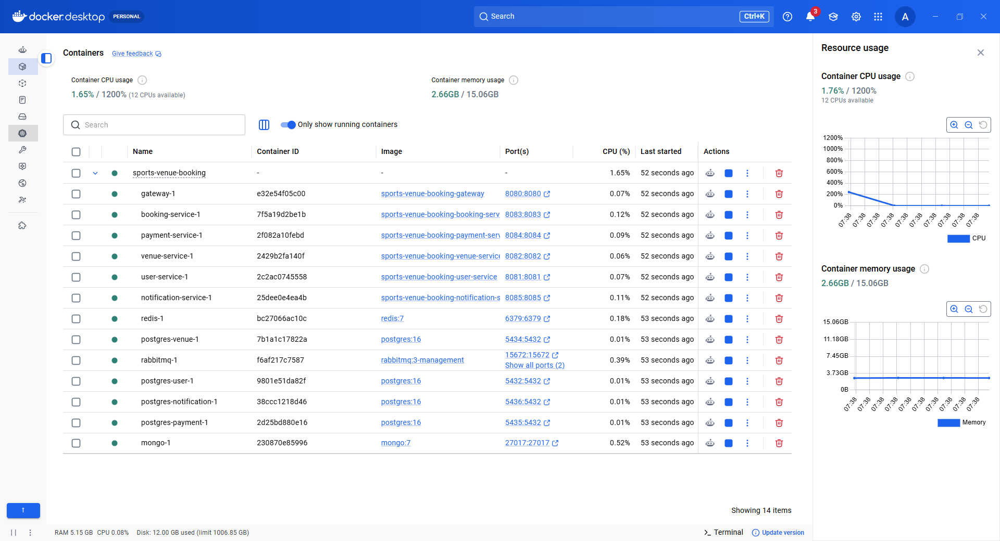

**CI** - required tests passing before a pull request can merge:

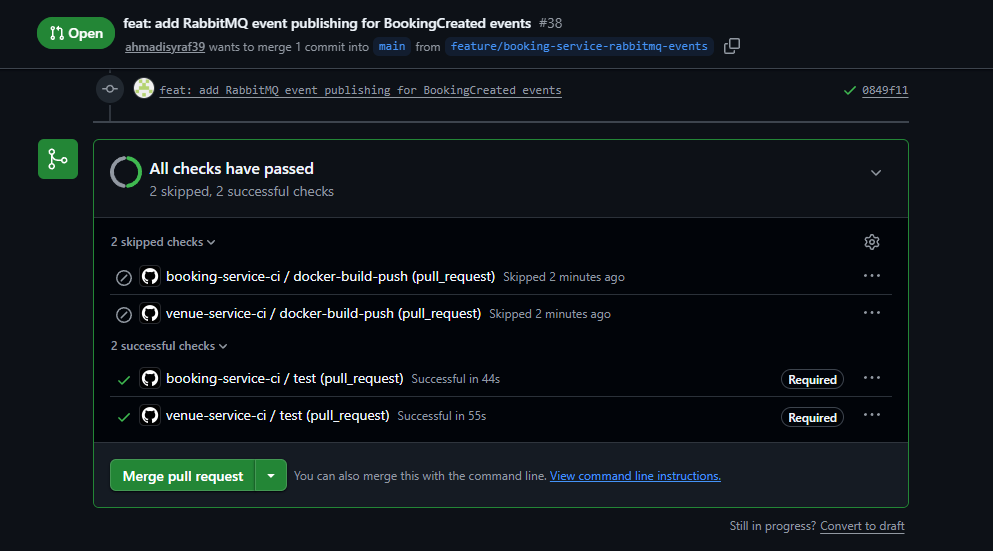

**CD** - Docker image built and pushed to GHCR on merge to `main`:

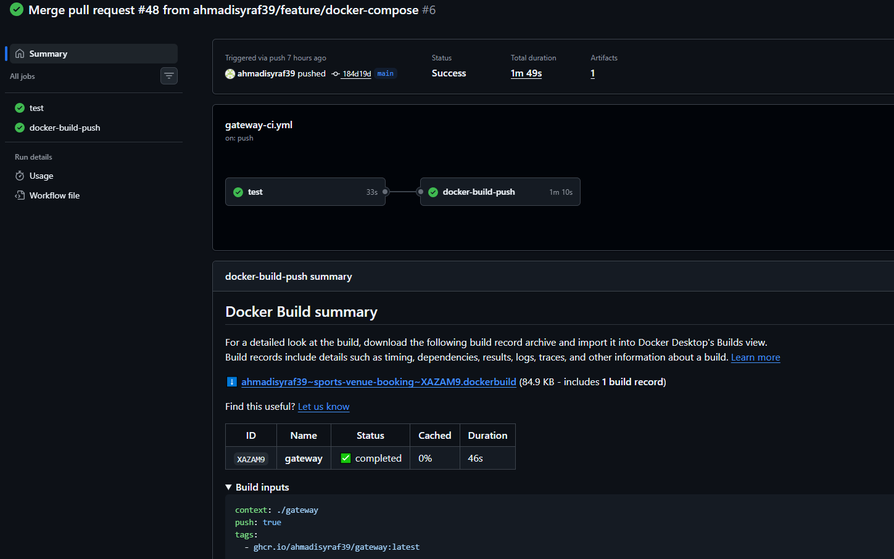

**Workflow history** - CI/CD runs across services over the project timeline:

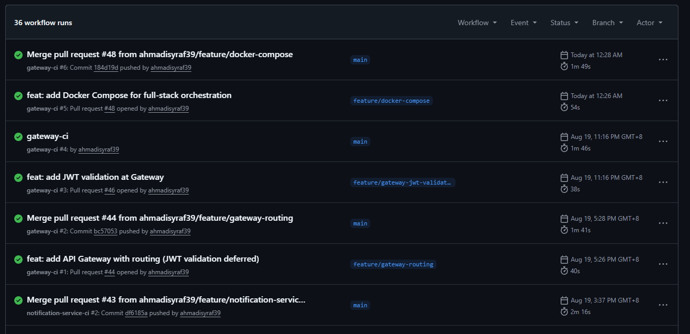

**End-to-end saga verification** - a real email landing in the Mailtrap
sandbox inbox after `POST /api/bookings` runs the full booking -> payment ->
notification chain (with `MAIL_HOST` pointed at Mailtrap):

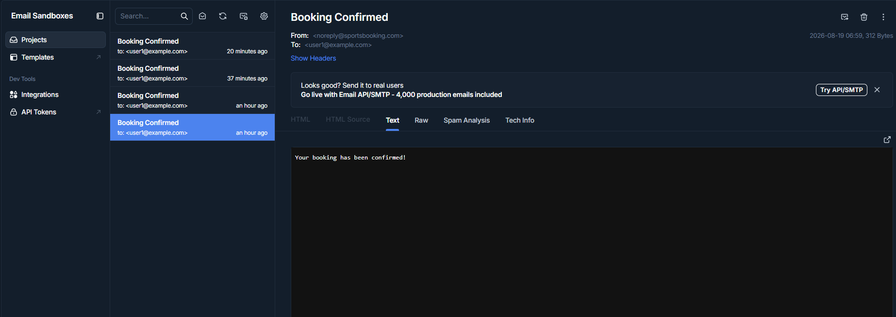

**Double-booking prevention** - the Redis-based slot lock rejecting a
conflicting booking for the same court/date/time:

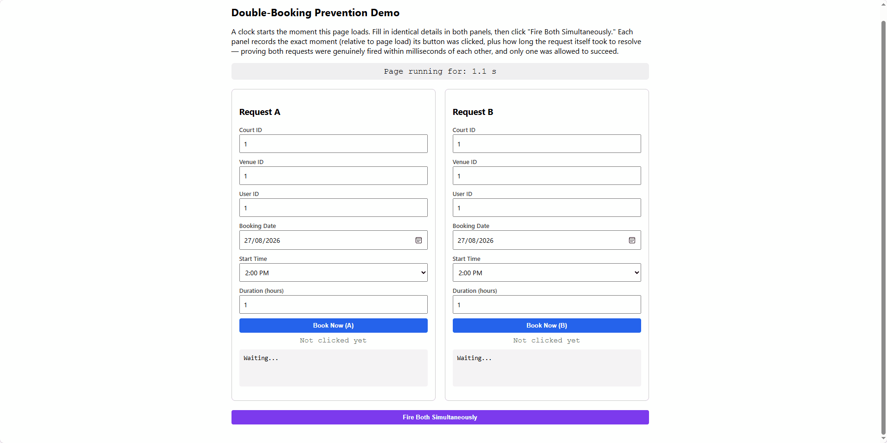

Firing both requests simultaneously to confirm the lock holds under a genuine
race, not just sequential requests:

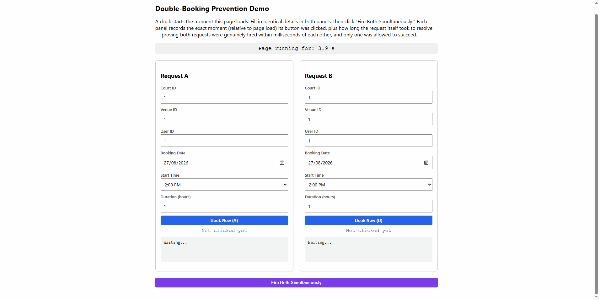

**Scaling demonstration** - JMeter load test (100 concurrent threads, 1000
requests) comparing booking-service at 1 replica vs 3 replicas; see
[`demo/SCALING_RESULTS.md`](./demo/SCALING_RESULTS.md) for full results:

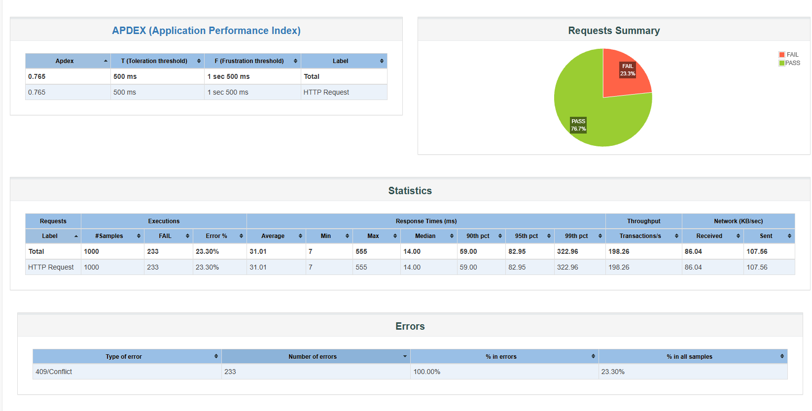

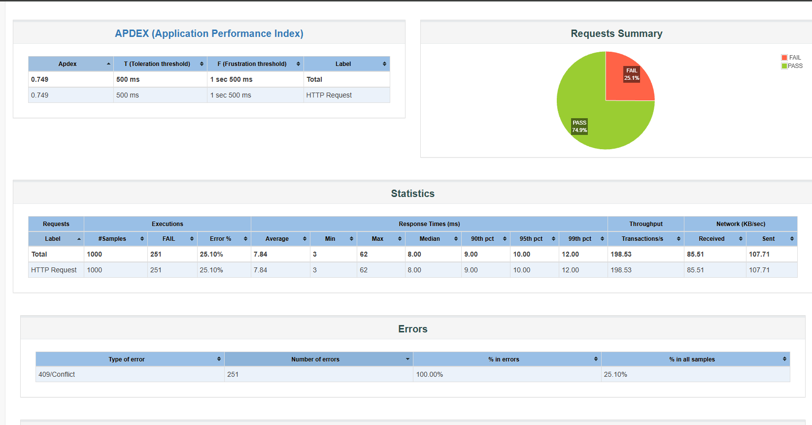

**Distributed tracing** - Zipkin capturing traces across all 6 services:

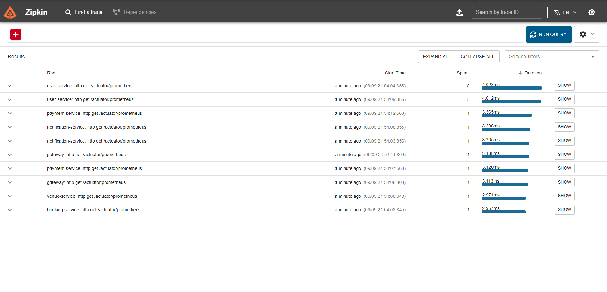

Drilling into a single trace shows the Spring Security filter chain spans for
`user-service`:

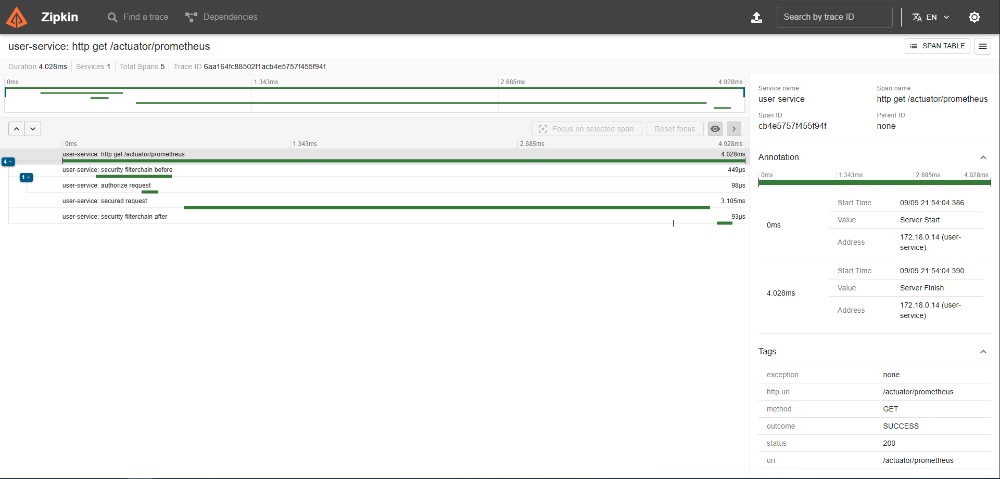

**Metrics** - Prometheus scraping all 6 services successfully:

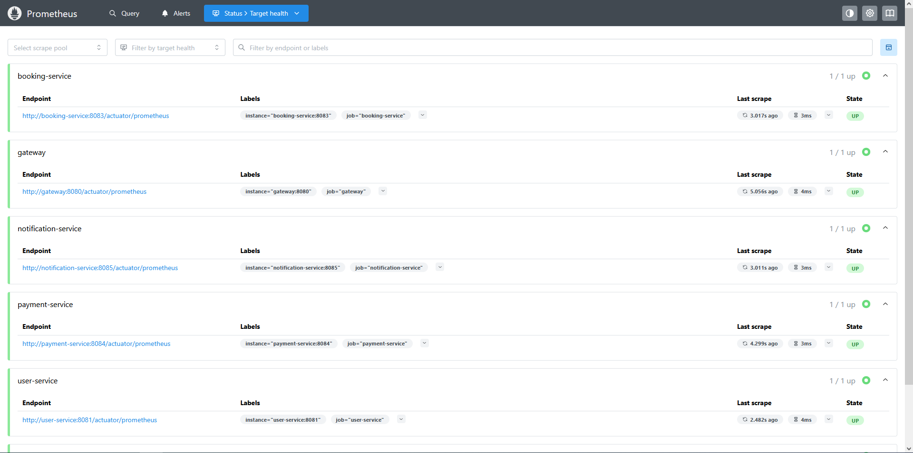

**Dashboards** - a Grafana dashboard visualizing request rate, latency, and
service health across the stack:

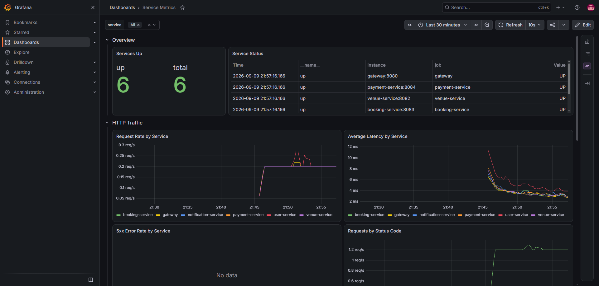

## AI-Assisted Development

Later services in this repo were scaffolded using Claude Code, after
establishing the architecture pattern manually in User Service (entities,
JWT auth, Docker, CI/CD - all built and debugged by hand first). Each
AI-generated service was thoroughly reviewed before merging, including
several real bugs and design gaps caught during review - see individual
service READMEs for the specific prompts used and documented findings:

- [`venue-service/README.md`](./venue-service)
- [`booking-service/README.md`](./booking-service)
- [`payment-service/README.md`](./payment-service)
- [`notification-service/README.md`](./notification-service)
- [`gateway/README.md`](./gateway)

AI was also used to help diagnose CI failures directly from job logs, e.g.
GitHub Copilot identifying a Testcontainers startup-timing issue in a
failing `payment-service` build:

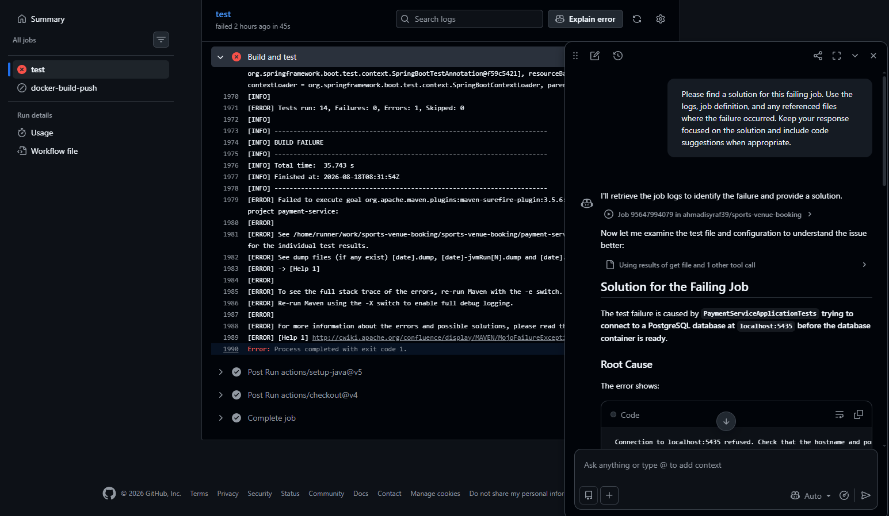

The end-to-end suite was written while learning Playwright, with Claude as a
tutor and reviewer. Every bug it found was reproduced with a failing test,
diagnosed from logs and code, and fixed with the failing test committed first.

## Roadmap

- [x] User Service - entities, JWT auth, Docker, CI/CD
- [x] Venue Service - CRUD, Docker, CI/CD (Claude Code-assisted, reviewed)
- [x] Booking Service - Saga orchestration, Redis locking, MongoDB, RabbitMQ
- [x] Payment Service - event-driven, simulated payment processing
- [x] Notification Service - event consumer, email delivery with status and retry
- [x] API Gateway - routing, JWT validation
- [x] Docker Compose - full system orchestration
- [x] End-to-end test suite (Playwright + pytest) running in CI on every pull request

**Optional enhancements (not required for core completeness):**

- [x] Observability stack (Prometheus, Grafana, Zipkin)
- [x] Scaling demonstration (horizontal scaling + load test)
- [x] Live double-booking prevention demo page
- [x] UI tests for the demo page (Playwright)
- [ ] Dead-letter queue for notification events that exhaust their retries
- [ ] Recommendation Service (stretch goal)
- [ ] Kubernetes deployment (stretch goal)

## License
